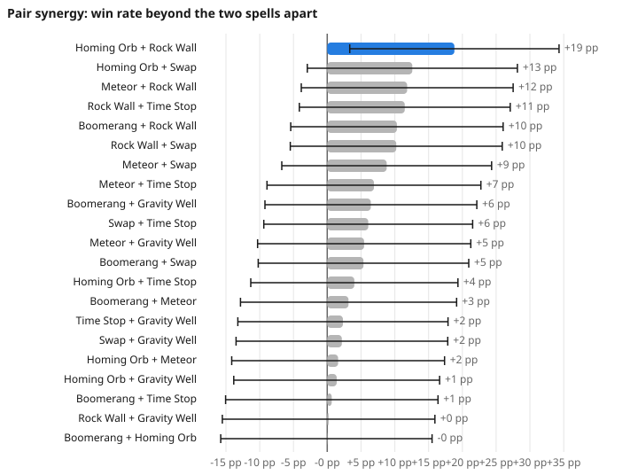
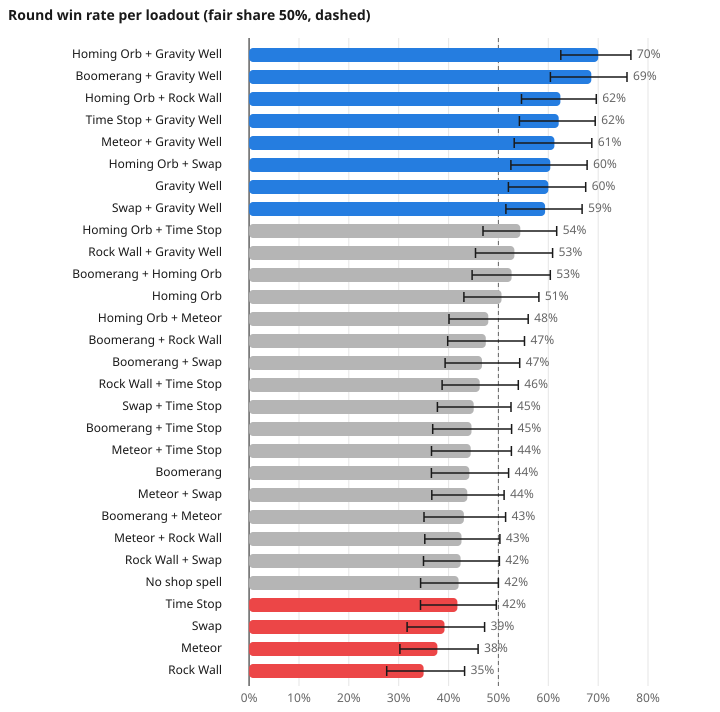

# Spell pair sim: duel (2 wizards)

2240 rounds, avg fight 51 s, 0 timeouts, deaths in lava 75%.
Every wizard is a neutral bot, all spells level 0, no items. Each round every wizard gets a random loadout
(no shop spell, one, or a pair) on top of the starters (Fireball, Blink, Lightning, Shield, Staff).

**Bias:** the bots pick each spell on its own merits and never plan combos, so this is the synergy that
happens naturally with these bots; planned combos (pull, then meteor) are under-counted.

Colours: blue = clearly above (CI above 0 / above fair share), red = clearly below, gray = can't tell from noise.

## Synergy (pairs)

| Pair | Synergy | 95% CI | Pair win rate | n | Verdict |
|---|---|---|---|---|---|
| Homing Orb + Rock Wall | +18.8 pp | +3.3 to +34.3 | 62% | 157 | real combo |
| Homing Orb + Swap | +12.6 pp | -3.0 to +28.1 | 60% | 154 | noise |
| Meteor + Rock Wall | +11.8 pp | -3.9 to +27.5 | 43% | 162 | noise |
| Rock Wall + Time Stop | +11.5 pp | -4.1 to +27.1 | 46% | 160 | noise |
| Boomerang + Rock Wall | +10.3 pp | -5.4 to +26.0 | 47% | 158 | noise |
| Rock Wall + Swap | +10.2 pp | -5.5 to +25.9 | 42% | 158 | noise |
| Meteor + Swap | +8.8 pp | -6.7 to +24.3 | 44% | 176 | noise |
| Meteor + Time Stop | +6.9 pp | -8.9 to +22.7 | 44% | 144 | noise |
| Boomerang + Gravity Well | +6.5 pp | -9.2 to +22.1 | 69% | 137 | noise |
| Swap + Time Stop | +6.1 pp | -9.4 to +21.5 | 45% | 171 | noise |
| Meteor + Gravity Well | +5.5 pp | -10.3 to +21.2 | 61% | 147 | noise |
| Boomerang + Swap | +5.4 pp | -10.2 to +21.0 | 47% | 167 | noise |
| Homing Orb + Time Stop | +4.0 pp | -11.3 to +19.3 | 54% | 171 | noise |
| Boomerang + Meteor | +3.1 pp | -12.8 to +19.1 | 43% | 137 | noise |
| Time Stop + Gravity Well | +2.3 pp | -13.2 to +17.9 | 62% | 153 | noise |
| Swap + Gravity Well | +2.2 pp | -13.5 to +17.8 | 59% | 155 | noise |
| Homing Orb + Meteor | +1.6 pp | -14.1 to +17.4 | 48% | 148 | noise |
| Homing Orb + Gravity Well | +1.4 pp | -13.8 to +16.6 | 70% | 160 | noise |
| Boomerang + Time Stop | +0.7 pp | -15.1 to +16.4 | 45% | 148 | noise |
| Rock Wall + Gravity Well | +0.2 pp | -15.5 to +15.9 | 53% | 156 | noise |
| Boomerang + Homing Orb | -0.1 pp | -15.8 to +15.5 | 53% | 152 | noise |

## Win rate per loadout

| Loadout | Win rate | 95% CI | n |
|---|---|---|---|
| Homing Orb + Gravity Well | 70.0% | 62.5% to 76.6% | 160 |
| Boomerang + Gravity Well | 68.6% | 60.4% to 75.8% | 137 |
| Homing Orb + Rock Wall | 62.4% | 54.6% to 69.6% | 157 |
| Time Stop + Gravity Well | 62.1% | 54.2% to 69.4% | 153 |
| Meteor + Gravity Well | 61.2% | 53.2% to 68.7% | 147 |
| Homing Orb + Swap | 60.4% | 52.5% to 67.8% | 154 |
| Gravity Well | 60.0% | 52.0% to 67.5% | 150 |
| Swap + Gravity Well | 59.4% | 51.5% to 66.8% | 155 |
| Homing Orb + Time Stop | 54.4% | 46.9% to 61.7% | 171 |
| Rock Wall + Gravity Well | 53.2% | 45.4% to 60.9% | 156 |
| Boomerang + Homing Orb | 52.6% | 44.7% to 60.4% | 152 |
| Homing Orb | 50.6% | 43.1% to 58.1% | 166 |
| Homing Orb + Meteor | 48.0% | 40.1% to 56.0% | 148 |
| Boomerang + Rock Wall | 47.5% | 39.8% to 55.2% | 158 |
| Boomerang + Swap | 46.7% | 39.3% to 54.3% | 167 |
| Rock Wall + Time Stop | 46.2% | 38.7% to 54.0% | 160 |
| Swap + Time Stop | 45.0% | 37.8% to 52.5% | 171 |
| Boomerang + Time Stop | 44.6% | 36.8% to 52.6% | 148 |
| Meteor + Time Stop | 44.4% | 36.6% to 52.6% | 144 |
| Boomerang | 44.2% | 36.5% to 52.0% | 154 |
| Meteor + Swap | 43.8% | 36.6% to 51.1% | 176 |
| Boomerang + Meteor | 43.1% | 35.1% to 51.4% | 137 |
| Meteor + Rock Wall | 42.6% | 35.2% to 50.3% | 162 |
| Rock Wall + Swap | 42.4% | 35.0% to 50.2% | 158 |
| No shop spell | 42.0% | 34.4% to 50.0% | 150 |
| Time Stop | 41.8% | 34.4% to 49.6% | 158 |
| Swap | 39.2% | 31.7% to 47.2% | 148 |
| Meteor | 37.8% | 30.2% to 45.9% | 143 |
| Rock Wall | 35.0% | 27.6% to 43.2% | 140 |
