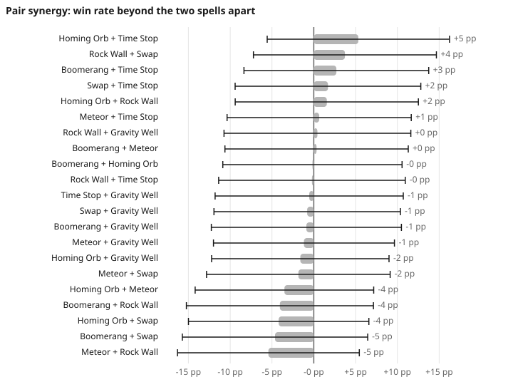
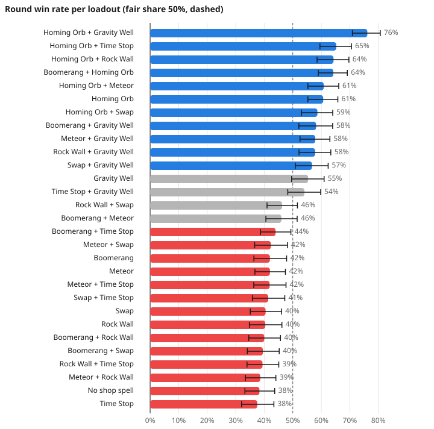

# Spell pair sim: duel (2 wizards)

4352 rounds, avg fight 50 s, 0 timeouts, deaths in lava 67%.
Every wizard is a neutral bot, all spells level 0, no items. Each round every wizard gets a random loadout
(no shop spell, one, or a pair) on top of the starters (Fireball, Blink, Lightning, Shield, Staff).

**Bias:** the bots pick each spell on its own merits and never plan combos, so this is the synergy that
happens naturally with these bots; planned combos (pull, then meteor) are under-counted.

Colours: blue = clearly above (CI above 0 / above fair share), red = clearly below, gray = can't tell from noise.

## Synergy (pairs)

| Pair | Synergy | 95% CI | Pair win rate | n | Verdict |
|---|---|---|---|---|---|
| Homing Orb + Time Stop | +5.3 pp | -5.6 to +16.2 | 65% | 282 | noise |
| Rock Wall + Swap | +3.7 pp | -7.2 to +14.7 | 46% | 333 | noise |
| Boomerang + Time Stop | +2.7 pp | -8.4 to +13.7 | 44% | 330 | noise |
| Swap + Time Stop | +1.7 pp | -9.4 to +12.8 | 41% | 285 | noise |
| Homing Orb + Rock Wall | +1.6 pp | -9.4 to +12.5 | 64% | 280 | noise |
| Meteor + Time Stop | +0.6 pp | -10.4 to +11.7 | 42% | 289 | noise |
| Rock Wall + Gravity Well | +0.4 pp | -10.7 to +11.6 | 58% | 299 | noise |
| Boomerang + Meteor | +0.3 pp | -10.6 to +11.3 | 46% | 313 | noise |
| Boomerang + Homing Orb | -0.2 pp | -10.9 to +10.6 | 64% | 338 | noise |
| Rock Wall + Time Stop | -0.2 pp | -11.4 to +10.9 | 39% | 292 | noise |
| Time Stop + Gravity Well | -0.5 pp | -11.8 to +10.7 | 54% | 283 | noise |
| Swap + Gravity Well | -0.8 pp | -11.9 to +10.4 | 57% | 282 | noise |
| Boomerang + Gravity Well | -0.9 pp | -12.3 to +10.5 | 58% | 263 | noise |
| Meteor + Gravity Well | -1.2 pp | -12.0 to +9.6 | 58% | 337 | noise |
| Homing Orb + Gravity Well | -1.6 pp | -12.2 to +9.0 | 76% | 289 | noise |
| Meteor + Swap | -1.8 pp | -12.8 to +9.1 | 42% | 279 | noise |
| Homing Orb + Meteor | -3.5 pp | -14.2 to +7.2 | 61% | 309 | noise |
| Boomerang + Rock Wall | -4.1 pp | -15.2 to +7.1 | 40% | 295 | noise |
| Homing Orb + Swap | -4.2 pp | -15.0 to +6.6 | 59% | 307 | noise |
| Boomerang + Swap | -4.6 pp | -15.7 to +6.4 | 40% | 291 | noise |
| Meteor + Rock Wall | -5.4 pp | -16.3 to +5.5 | 39% | 316 | noise |

## Win rate per loadout

| Loadout | Win rate | 95% CI | n |
|---|---|---|---|
| Homing Orb + Gravity Well | 76.1% | 70.9% to 80.7% | 289 |
| Homing Orb + Time Stop | 65.2% | 59.5% to 70.6% | 282 |
| Homing Orb + Rock Wall | 64.3% | 58.5% to 69.7% | 280 |
| Boomerang + Homing Orb | 64.2% | 59.0% to 69.1% | 338 |
| Homing Orb + Meteor | 60.8% | 55.3% to 66.1% | 309 |
| Homing Orb | 60.7% | 55.3% to 65.8% | 328 |
| Homing Orb + Swap | 58.6% | 53.0% to 64.0% | 307 |
| Boomerang + Gravity Well | 58.2% | 52.1% to 64.0% | 263 |
| Meteor + Gravity Well | 57.9% | 52.5% to 63.0% | 337 |
| Rock Wall + Gravity Well | 57.9% | 52.2% to 63.3% | 299 |
| Swap + Gravity Well | 56.7% | 50.9% to 62.4% | 282 |
| Gravity Well | 55.4% | 49.6% to 61.0% | 289 |
| Time Stop + Gravity Well | 54.1% | 48.2% to 59.8% | 283 |
| Rock Wall + Swap | 46.2% | 41.0% to 51.6% | 333 |
| Boomerang + Meteor | 46.0% | 40.6% to 51.5% | 313 |
| Boomerang + Time Stop | 43.9% | 38.7% to 49.3% | 330 |
| Meteor + Swap | 42.3% | 36.6% to 48.2% | 279 |
| Boomerang | 42.0% | 36.4% to 47.8% | 281 |
| Meteor | 42.0% | 36.7% to 47.4% | 324 |
| Meteor + Time Stop | 41.9% | 36.3% to 47.6% | 289 |
| Swap + Time Stop | 41.4% | 35.8% to 47.2% | 285 |
| Swap | 40.5% | 35.1% to 46.1% | 304 |
| Rock Wall | 40.4% | 34.8% to 46.2% | 280 |
| Boomerang + Rock Wall | 40.0% | 34.6% to 45.7% | 295 |
| Boomerang + Swap | 39.5% | 34.1% to 45.2% | 291 |
| Rock Wall + Time Stop | 39.4% | 34.0% to 45.1% | 292 |
| Meteor + Rock Wall | 38.6% | 33.4% to 44.1% | 316 |
| No shop spell | 38.3% | 33.2% to 43.7% | 329 |
| Time Stop | 37.5% | 32.0% to 43.4% | 277 |
