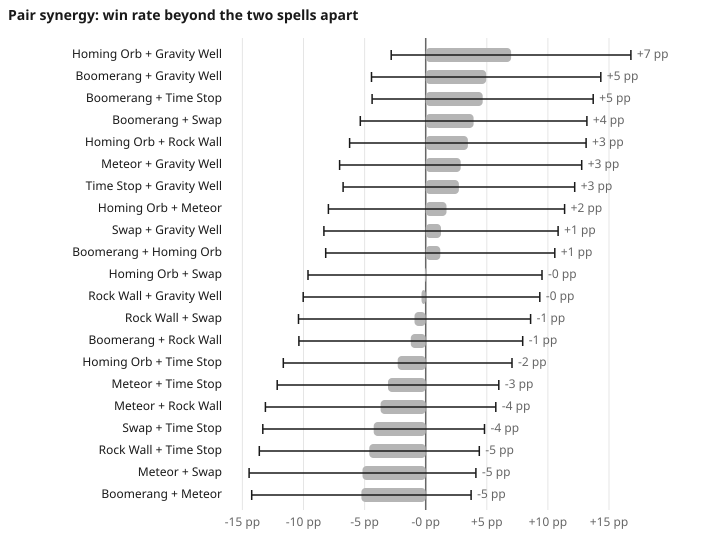
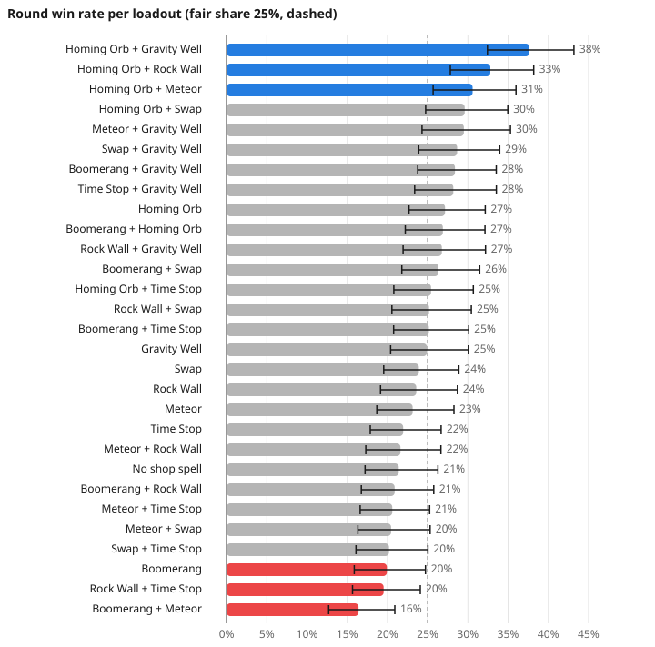

# Spell pair sim: ffa (4 wizards)

2240 rounds, avg fight 56 s, 0 timeouts, deaths in lava 71%.
Every wizard is a neutral bot, all spells level 0, no items. Each round every wizard gets a random loadout
(no shop spell, one, or a pair) on top of the starters (Fireball, Blink, Lightning, Shield, Staff).

**Bias:** the bots pick each spell on its own merits and never plan combos, so this is the synergy that
happens naturally with these bots; planned combos (pull, then meteor) are under-counted.

Colours: blue = clearly above (CI above 0 / above fair share), red = clearly below, gray = can't tell from noise.

## Synergy (pairs)

| Pair | Synergy | 95% CI | Pair win rate | n | Verdict |
|---|---|---|---|---|---|
| Homing Orb + Gravity Well | +7.0 pp | -2.8 to +16.8 | 38% | 308 | noise |
| Boomerang + Gravity Well | +4.9 pp | -4.4 to +14.3 | 28% | 324 | noise |
| Boomerang + Time Stop | +4.7 pp | -4.4 to +13.7 | 25% | 330 | noise |
| Boomerang + Swap | +3.9 pp | -5.4 to +13.2 | 26% | 315 | noise |
| Homing Orb + Rock Wall | +3.5 pp | -6.2 to +13.1 | 33% | 311 | noise |
| Meteor + Gravity Well | +2.9 pp | -7.0 to +12.8 | 30% | 261 | noise |
| Time Stop + Gravity Well | +2.7 pp | -6.8 to +12.2 | 28% | 298 | noise |
| Homing Orb + Meteor | +1.7 pp | -8.0 to +11.4 | 31% | 304 | noise |
| Swap + Gravity Well | +1.3 pp | -8.3 to +10.8 | 29% | 307 | noise |
| Boomerang + Homing Orb | +1.2 pp | -8.2 to +10.6 | 27% | 305 | noise |
| Homing Orb + Swap | -0.1 pp | -9.6 to +9.5 | 30% | 304 | noise |
| Rock Wall + Gravity Well | -0.3 pp | -10.0 to +9.3 | 27% | 284 | noise |
| Rock Wall + Swap | -0.9 pp | -10.4 to +8.6 | 25% | 294 | noise |
| Boomerang + Rock Wall | -1.2 pp | -10.4 to +7.9 | 21% | 311 | noise |
| Homing Orb + Time Stop | -2.3 pp | -11.7 to +7.1 | 25% | 295 | noise |
| Meteor + Time Stop | -3.1 pp | -12.1 to +6.0 | 21% | 335 | noise |
| Meteor + Rock Wall | -3.7 pp | -13.1 to +5.7 | 22% | 296 | noise |
| Swap + Time Stop | -4.3 pp | -13.3 to +4.8 | 20% | 307 | noise |
| Rock Wall + Time Stop | -4.6 pp | -13.6 to +4.4 | 20% | 338 | noise |
| Meteor + Swap | -5.2 pp | -14.4 to +4.1 | 20% | 308 | noise |
| Boomerang + Meteor | -5.3 pp | -14.2 to +3.7 | 16% | 311 | noise |

## Win rate per loadout

| Loadout | Win rate | 95% CI | n |
|---|---|---|---|
| Homing Orb + Gravity Well | 37.7% | 32.4% to 43.2% | 308 |
| Homing Orb + Rock Wall | 32.8% | 27.8% to 38.2% | 311 |
| Homing Orb + Meteor | 30.6% | 25.7% to 36.0% | 304 |
| Homing Orb + Swap | 29.6% | 24.8% to 35.0% | 304 |
| Meteor + Gravity Well | 29.5% | 24.3% to 35.3% | 261 |
| Swap + Gravity Well | 28.7% | 23.9% to 34.0% | 307 |
| Boomerang + Gravity Well | 28.4% | 23.8% to 33.5% | 324 |
| Time Stop + Gravity Well | 28.2% | 23.4% to 33.5% | 298 |
| Homing Orb | 27.2% | 22.7% to 32.2% | 335 |
| Boomerang + Homing Orb | 26.9% | 22.2% to 32.1% | 305 |
| Rock Wall + Gravity Well | 26.8% | 21.9% to 32.2% | 284 |
| Boomerang + Swap | 26.3% | 21.8% to 31.5% | 315 |
| Homing Orb + Time Stop | 25.4% | 20.8% to 30.7% | 295 |
| Rock Wall + Swap | 25.2% | 20.6% to 30.4% | 294 |
| Boomerang + Time Stop | 25.2% | 20.8% to 30.1% | 330 |
| Gravity Well | 24.9% | 20.4% to 30.1% | 305 |
| Swap | 23.9% | 19.5% to 28.9% | 318 |
| Rock Wall | 23.6% | 19.1% to 28.7% | 301 |
| Meteor | 23.1% | 18.7% to 28.3% | 294 |
| Time Stop | 22.0% | 17.9% to 26.7% | 337 |
| Meteor + Rock Wall | 21.6% | 17.3% to 26.7% | 296 |
| No shop spell | 21.4% | 17.2% to 26.3% | 313 |
| Boomerang + Rock Wall | 20.9% | 16.8% to 25.8% | 311 |
| Meteor + Time Stop | 20.6% | 16.6% to 25.2% | 335 |
| Meteor + Swap | 20.5% | 16.3% to 25.3% | 308 |
| Swap + Time Stop | 20.2% | 16.1% to 25.0% | 307 |
| Boomerang | 19.9% | 15.9% to 24.7% | 311 |
| Rock Wall + Time Stop | 19.5% | 15.7% to 24.1% | 338 |
| Boomerang + Meteor | 16.4% | 12.7% to 20.9% | 311 |
