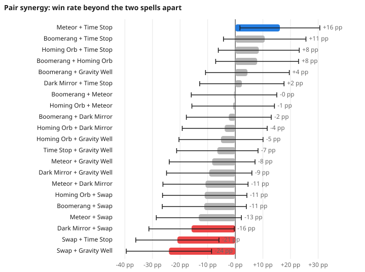
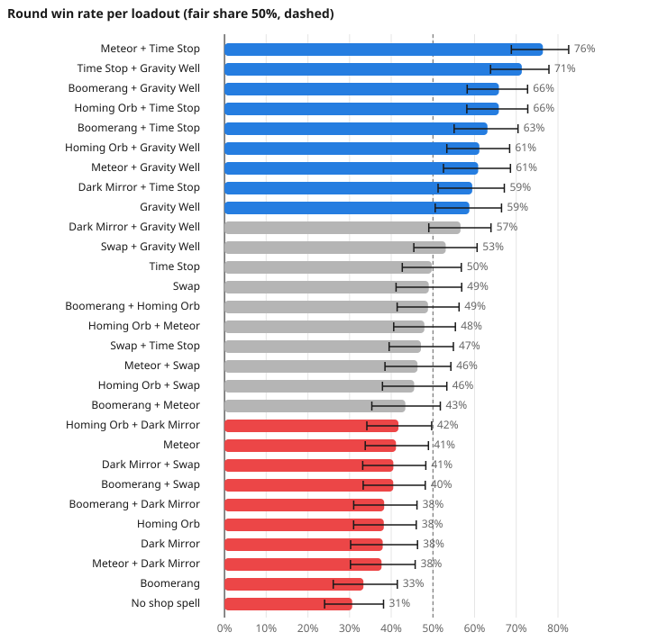

# Spell pair sim: duel (2 wizards)

2240 rounds, avg fight 49 s, 0 timeouts, deaths in lava 72%.
Every wizard is a neutral bot, all spells level 0, no items. Each round every wizard gets a random loadout
(no shop spell, one, or a pair) on top of the starters (Fireball, Blink, Lightning, Shield, Staff).

**Bias:** the bots pick each spell on its own merits and never plan combos, so this is the synergy that
happens naturally with these bots; planned combos (pull, then meteor) are under-counted.

Colours: blue = clearly above (CI above 0 / above fair share), red = clearly below, gray = can't tell from noise.

## Synergy (pairs)

| Pair | Synergy | 95% CI | Pair win rate | n | Verdict |
|---|---|---|---|---|---|
| Meteor + Time Stop | +16.1 pp | +1.7 to +30.6 | 76% | 144 | real combo |
| Boomerang + Time Stop | +10.6 pp | -4.3 to +25.6 | 63% | 149 | noise |
| Homing Orb + Time Stop | +8.5 pp | -6.2 to +23.2 | 66% | 158 | noise |
| Boomerang + Homing Orb | +7.9 pp | -7.1 to +22.9 | 49% | 170 | noise |
| Boomerang + Gravity Well | +4.4 pp | -10.8 to +19.6 | 66% | 161 | noise |
| Dark Mirror + Time Stop | +2.4 pp | -12.9 to +17.6 | 59% | 143 | noise |
| Boomerang + Meteor | -0.5 pp | -16.0 to +15.0 | 43% | 136 | noise |
| Homing Orb + Meteor | -0.8 pp | -15.7 to +14.2 | 48% | 171 | noise |
| Boomerang + Dark Mirror | -2.4 pp | -17.7 to +13.0 | 38% | 154 | noise |
| Homing Orb + Dark Mirror | -3.8 pp | -19.2 to +11.6 | 42% | 151 | noise |
| Homing Orb + Gravity Well | -5.2 pp | -20.4 to +10.0 | 61% | 157 | noise |
| Time Stop + Gravity Well | -6.5 pp | -21.3 to +8.2 | 71% | 157 | noise |
| Meteor + Gravity Well | -8.4 pp | -23.9 to +7.1 | 61% | 138 | noise |
| Dark Mirror + Gravity Well | -9.4 pp | -24.9 to +6.0 | 57% | 166 | noise |
| Meteor + Dark Mirror | -10.8 pp | -26.2 to +4.6 | 38% | 146 | noise |
| Homing Orb + Swap | -11.1 pp | -26.4 to +4.2 | 46% | 156 | noise |
| Boomerang + Swap | -11.2 pp | -26.5 to +4.0 | 40% | 163 | noise |
| Meteor + Swap | -13.2 pp | -28.6 to +2.2 | 46% | 149 | noise |
| Dark Mirror + Swap | -15.8 pp | -31.3 to -0.4 | 41% | 158 | anti-combo |
| Swap + Time Stop | -21.0 pp | -36.0 to -5.9 | 47% | 157 | anti-combo |
| Swap + Gravity Well | -24.0 pp | -39.5 to -8.6 | 53% | 162 | anti-combo |

## Win rate per loadout

| Loadout | Win rate | 95% CI | n |
|---|---|---|---|
| Meteor + Time Stop | 76.4% | 68.8% to 82.6% | 144 |
| Time Stop + Gravity Well | 71.3% | 63.8% to 77.8% | 157 |
| Boomerang + Gravity Well | 65.8% | 58.2% to 72.7% | 161 |
| Homing Orb + Time Stop | 65.8% | 58.1% to 72.8% | 158 |
| Boomerang + Time Stop | 63.1% | 55.1% to 70.4% | 149 |
| Homing Orb + Gravity Well | 61.1% | 53.3% to 68.4% | 157 |
| Meteor + Gravity Well | 60.9% | 52.5% to 68.6% | 138 |
| Dark Mirror + Time Stop | 59.4% | 51.2% to 67.1% | 143 |
| Gravity Well | 58.7% | 50.5% to 66.5% | 143 |
| Dark Mirror + Gravity Well | 56.6% | 49.0% to 63.9% | 166 |
| Swap + Gravity Well | 53.1% | 45.4% to 60.6% | 162 |
| Time Stop | 49.7% | 42.6% to 56.8% | 187 |
| Swap | 49.0% | 41.2% to 56.9% | 151 |
| Boomerang + Homing Orb | 48.8% | 41.4% to 56.3% | 170 |
| Homing Orb + Meteor | 48.0% | 40.6% to 55.4% | 171 |
| Swap + Time Stop | 47.1% | 39.5% to 54.9% | 157 |
| Meteor + Swap | 46.3% | 38.5% to 54.3% | 149 |
| Homing Orb + Swap | 45.5% | 37.9% to 53.3% | 156 |
| Boomerang + Meteor | 43.4% | 35.3% to 51.8% | 136 |
| Homing Orb + Dark Mirror | 41.7% | 34.2% to 49.7% | 151 |
| Meteor | 41.1% | 33.8% to 48.9% | 158 |
| Dark Mirror + Swap | 40.5% | 33.2% to 48.3% | 158 |
| Boomerang + Swap | 40.5% | 33.3% to 48.2% | 163 |
| Boomerang + Dark Mirror | 38.3% | 31.0% to 46.2% | 154 |
| Homing Orb | 38.2% | 31.0% to 46.0% | 157 |
| Dark Mirror | 38.0% | 30.3% to 46.3% | 137 |
| Meteor + Dark Mirror | 37.7% | 30.2% to 45.8% | 146 |
| Boomerang | 33.3% | 26.1% to 41.5% | 141 |
| No shop spell | 30.6% | 24.0% to 38.2% | 160 |
